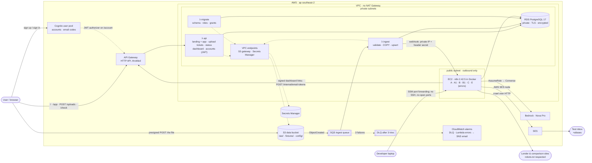
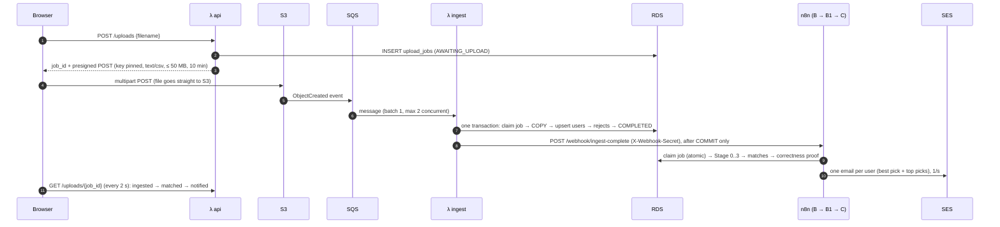
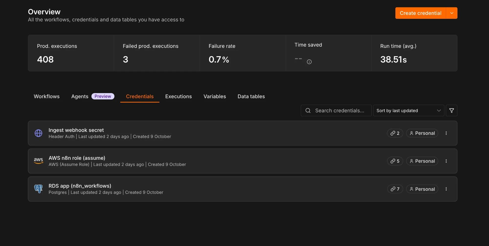
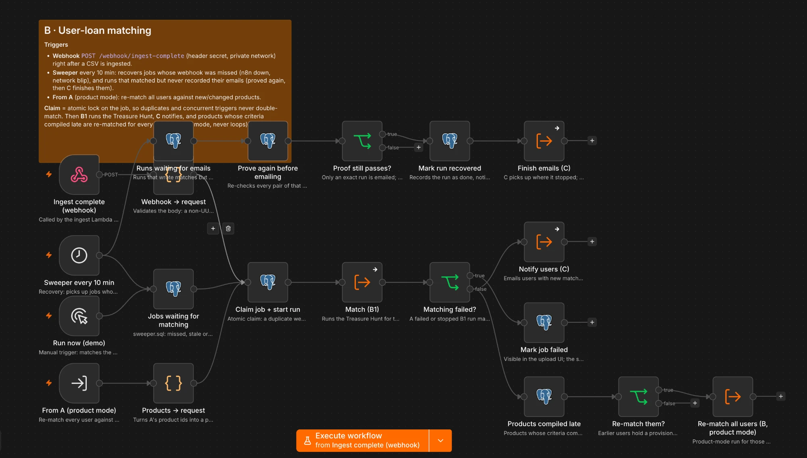
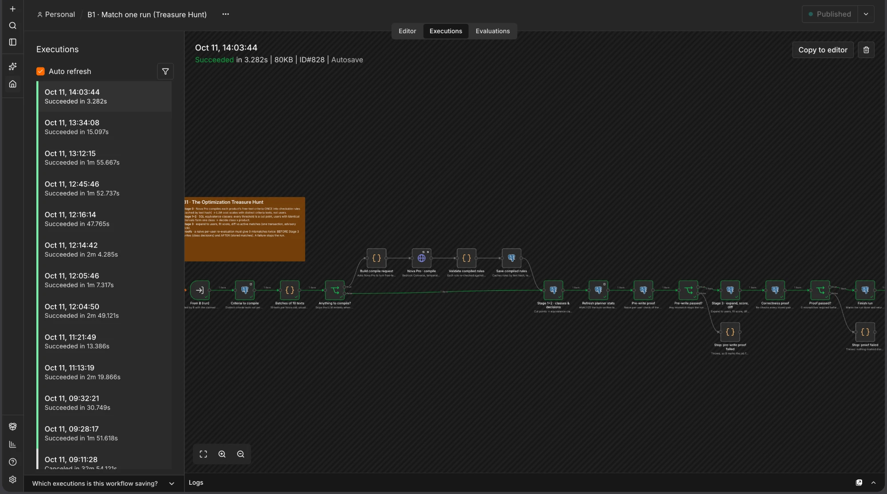
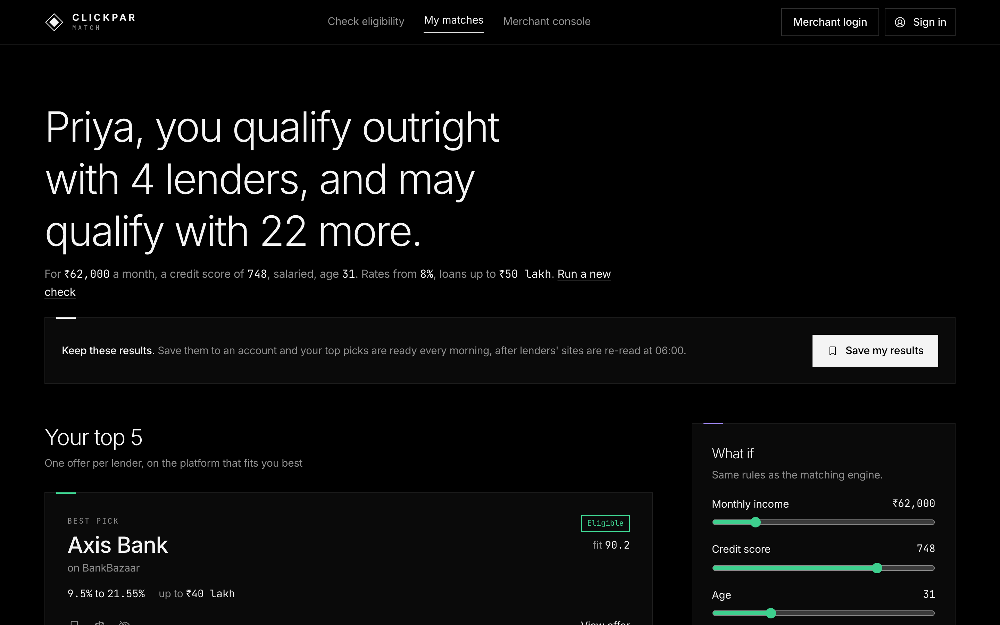
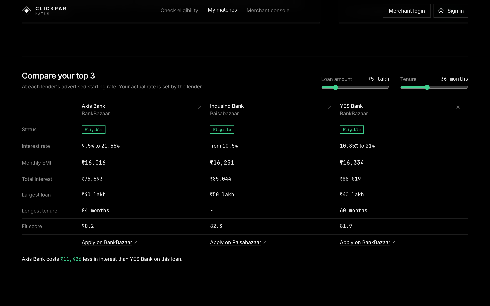

# Loan Eligibility Engine

An event-driven system on **AWS + self-hosted n8n** that ingests a users CSV, discovers
personal-loan products by crawling lender and comparison sites, matches every user to the
products they are likely eligible for, and emails each matched user their best options.

| | |
|---|---|
| **Live upload UI** (merchant console: sign up with any email, then upload) | https://t7lcgp5o0j.execute-api.ap-southeast-2.amazonaws.com/app/merchant |
| **Landing + app** (extra) | https://t7lcgp5o0j.execute-api.ap-southeast-2.amazonaws.com/ (app at `/app/`, [§14](#14-extra-landing-page-app-and-accounts-one-product)) |
| **Region** | `ap-southeast-2` (Sydney): the only region this AWS account's organization allows (see [Trade-offs](#11-trade-offs--production-next-steps)) |
| **n8n** | self-hosted 2.42.5 on EC2, **not exposed to the internet**: reached through an SSM tunnel |
| **LLM** | Amazon Bedrock · Nova Pro (temperature 0), via n8n with **no AWS access keys** |
| **Email** | Amazon SES via n8n's **AWS SES node**, to the owner's test `+aliases` only |
| **Proof** | [`docs/evidence/REQUIRED_PATH.md`](docs/evidence/REQUIRED_PATH.md): each required path checked on the live stack (n8n execution log, RDS rows, emails, CI) · [screenshots](docs/screenshots/) |

**Headline result (measured, not estimated):** matching 10,000 users against 59 crawled
products would be **590,000** user×product evaluations for a naive LLM approach. The
pipeline reduced that to **164 equivalence classes** and **5 LLM calls in total (≈ $0.024)**,
then **0 calls** on every later run, and a brute-force check proves the optimized result is
**identical** to evaluating all 590,000 pairs one by one.

---

## Contents
1. [What happens end to end](#1-what-happens-end-to-end)
2. [Architecture](#2-architecture)
3. [Design decisions](#3-design-decisions)
4. [Deploy step by step](#4-deploy-step-by-step)
5. [Configuring credentials inside n8n](#5-configuring-credentials-inside-n8n)
6. [Workflows A / B / C node by node](#6-workflows-a--b--c-node-by-node)
7. [Web crawling strategy](#7-web-crawling-strategy)
8. [The Optimization Treasure Hunt](#8-the-optimization-treasure-hunt)
9. [Failure handling](#9-failure-handling)
10. [Security](#10-security)
11. [Trade-offs & production next steps](#11-trade-offs--production-next-steps)
12. [Code quality & tests](#12-code-quality--tests)
13. [Repository layout](#13-repository-layout)
14. [Extra: landing page, app and accounts](#14-extra-landing-page-app-and-accounts-one-product)

---

## 1. What happens end to end

1. **Upload**: the merchant signs in to the upload page and picks a CSV. The page asks the API for an
   upload ticket (a **presigned POST**), then sends the file **straight to S3**: the API never
   handles the file, so API Gateway's request size and time limits do not apply.
2. **Ingest**: S3 drops an event on an **SQS queue**; the **ingest Lambda** (inside the VPC)
   reads the CSV line by line from S3, validates every row, and loads the valid rows into
   **RDS PostgreSQL** with one `COPY`, in one transaction.
   Bad rows are stored with their line number and reason and shown in the UI.
3. **Match (Workflow B)**: after the commit, the Lambda calls an **n8n webhook** over the private
   network. B claims the job, runs the multi-stage matching pipeline, and writes `matches`.
4. **Notify (Workflow C)**: B hands over to C, which emails each user with new matches their
   **best pick + top picks** through the **AWS SES node**.
5. **Discover (Workflow A)**: independently, **every day at 06:00 IST**, A crawls lender and
   comparison sites, extracts eligibility criteria with Nova Pro, and keeps `loan_products` fresh.

The upload page tracks every stage live (Uploaded → Ingested → Matched → Notified).

---

## 2. Architecture





**Why n8n sits in a public subnet but is private:** it needs *outbound* internet (lender sites,
Bedrock, SES) and there is no NAT Gateway, so it has a public IP for egress only. Its security
group allows **one** inbound rule: TCP 5678 from the ingest Lambda's security group (the
webhook). No SSH, no port 80/443, no editor exposure; the editor is opened through SSM.

---

## 3. Design decisions

| Decision | Why |
|---|---|
| **Claim-check upload**: presigned POST → S3 → SQS → Lambda | The assignment warns that a Lambda-backed API endpoint hits size/time limits. The browser uploads directly to S3; S3 enforces the key (`raw/<job_id>.csv`), content type and 1 B–50 MB size itself. |
| **SQS between S3 and the Lambda** (not a direct S3 trigger) | Retries with a 720 s visibility timeout (6× the function timeout), a dead-letter queue after 3 failures, and `maximumConcurrency: 2` to protect RDS connections. |
| **One transaction per file** | A job is either fully loaded or not at all. `SELECT … FOR UPDATE SKIP LOCKED` makes duplicate deliveries harmless; the webhook fires only after COMMIT. |
| **Idempotent upsert** | Users are upserted only when values actually change (`IS DISTINCT FROM`); unchanged users keep their old job id, so re-uploading the same file creates **0** new matches and **0** emails (verified live). |
| **No NAT Gateway; VPC endpoints instead** | Private Lambdas only need S3 and Secrets Manager. Endpoints are cheaper and do not open a path to the whole internet. |
| **Least-privilege everywhere** | One IAM role per Lambda scoped to exact ARNs; three Postgres roles (§10); n8n's AWS access is a role that can only send email and call Nova Pro. |
| **n8n stores its own data in RDS** | Workflows, credentials and executions survive an instance rebuild. The credential-encryption key lives in Secrets Manager with `DeletionPolicy: Retain`. |
| **Pinned versions** | n8n 2.42.5, Postgres 17.11, AMI id, Docker Compose 5.5.1 (SHA-256 checked), Playwright 1.63.0: a redeploy can never silently change behavior. |
| **Pluggable seams** | Validation rules (`VALIDATION_RULES` env JSON), the next-stage notifier (`Notifier` protocol), crawl sources (`crawl_sources` table), and prompts (versioned files) change by config, not by rewriting infrastructure. |
| **Text JSON, not a forced tool call** (measured) | Tried Bedrock's schema-forced tool use (`toolChoice.tool`) for both Nova calls. Values were identical on a single page, but on a real 5-page batch Nova called the tool **once** and returned only **1–2 of 5 pages** (live crawl: 19 of 25 pages failed safe). Text mode returns 5/5 (40/40 on the full crawl), so batching wins: the answer stays a JSON array, parsed defensively, and every quote is verified against the page. |
| **FastAPI behind API Gateway, one Lambda** (Mangum adapter) | API Gateway keeps the edge: routes, throttling and the Cognito JWT authorizer. Inside the api Lambda, FastAPI declares each endpoint as a typed function: path ids are parsed as UUIDs (bad ones → 400), and auth is a dependency (`Borrower`, `SignedIn`, `Admin`). Every error has one shape, `{"error": …}`. Interactive docs are served at `/api/docs`. Cost: cold start went from ≈ 0.6 s to ≈ 0.7–1.3 s (measured), only on the first request of a fresh container. Response models are switched off so database decimals stay JSON numbers; a test pins this. Migrated with 31 live requests diffed before and after (identical) plus the full upload → B → C path re-run live. |
| **Workflow JSON is generated** | `n8n/build_workflows.py` assembles every Code node from `n8n/code/*.js` (unit-tested with `node --test`) and every prompt from `n8n/prompts/*.md`, so the running workflow can never drift from the tested code. |

The full reasoning trail, including what changed when reality disagreed with the plan, is in
the decision log at the end of [PLAN.md](PLAN.md).

---

## 4. Deploy step by step

### 4.1 Prerequisites
- AWS CLI v2 (logged in), the **Session Manager plugin**, Node.js 18+, **Serverless Framework v4**
  (`npm i -g serverless`, then `serverless login`), Python 3.12 (e.g. `uv python install 3.12`), Docker.
- **SES**: verify the sender and each test alias (sandbox mode sends to verified addresses only):
  ```bash
  for e in you@gmail.com you+one@gmail.com you+two@gmail.com you+three@gmail.com; do
    aws sesv2 create-email-identity --region ap-southeast-2 --email-identity "$e"; done
  ```
  Click the four verification links. Then set `SES_FROM` / `TEST_ALIASES` in `n8n/build_workflows.py`.
  (Identities are created by hand on purpose: each one needs its owner to click the emailed link,
  which CloudFormation cannot do; the stack only grants n8n permission to send from them.)
- **Bedrock**: Amazon Nova Pro is available by default in `ap-southeast-2` (no model-access form).

### 4.2 Python environment (also used to package the Lambdas)
```bash
uv venv --python 3.12 && uv pip install -r requirements-dev.txt pip
```

### 4.3 Deploy the AWS stack (everything is in `serverless.yml`)
Run these in order (each step needs the previous one):
```bash
scripts/build-frontends.sh       # 1. landing (web/) + app (dashboard/) into the api package
serverless deploy                # 2. VPC, endpoints, RDS, S3, SQS/DLQ, alarms, Lambdas, API, Cognito, EC2, IAM, secrets (~15 min first time)
scripts/n8n-sync.sh push         # 3. n8n's boot script + compose file to the bucket created in step 2
aws lambda invoke --function-name loan-engine-dev-migrate --payload '{}' /tmp/out.json && cat /tmp/out.json   # 4.
```
- Step 3 can only run after step 2 (it reads the bucket name from the stack). The EC2 instance
  created in step 2 simply waits, retrying every 15 s, until the boot script appears.
- Step 4 (`migrate`) applies `sql/001…009` once each, creates the three database roles with
  passwords generated in Secrets Manager, re-applies `sql/R__grants.sql`, and creates n8n's
  database and its `n8n_meta` role. n8n becomes healthy only after this step.
- Confirm the SNS email ("AWS Notification - Subscription Confirmation") sent to the alarm alias,
  so CloudWatch alarms (DLQ not empty, Lambda errors) reach you.

The EC2 instance boots n8n by itself (`deploy/n8n/boot.sh`, about 2–3 minutes): it installs Docker,
reads its secrets through the instance role, writes `.env` (mode 600), and starts the container.

### 4.4 Open n8n, create the owner account and the 3 credentials
```bash
scripts/tunnel-n8n.sh            # keep running, open http://localhost:5678
```
Then follow [§5](#5-configuring-credentials-inside-n8n).

### 4.5 Import the workflows
The exports reference credentials by id. On a fresh n8n, put the ids of the three credentials you
created in §5 (open each credential: the id is in the URL) into the environment, then regenerate:
```bash
export N8N_CRED_PG=<postgres id> N8N_CRED_AWS=<aws id> N8N_CRED_WEBHOOK=<header auth id>
.venv/bin/python n8n/build_workflows.py   # regenerate n8n/workflows/*.json from tested sources
scripts/n8n-workflows.sh import           # import + publish via the n8n CLI over SSM
scripts/n8n-workflows.sh run LoanEngineWfA001   # first crawl now (otherwise daily 06:00 IST)
```

### 4.6 Try it
Open `<UploadUiUrl>app/merchant` (output `UploadUiUrl` from `serverless info`), create an account
(email + password, confirmed with an emailed code), and upload a CSV. Uploads belong to the
signed-in account, so several reviewers can share one database without seeing each other's files.
From a terminal (the password is typed into `id-token.sh`, never echoed):
```bash
export ID_TOKEN="$(scripts/id-token.sh you@example.com)"
scripts/upload-sample.sh "$(scripts/stack-output.sh UploadUiUrl)" tests/fixtures/demo_users.csv
```


### 4.7 Run n8n locally without AWS (for reviewers)
```bash
cp .env.example .env && docker compose --profile local up -d   # n8n + a local Postgres
```

---

## 5. Configuring credentials inside n8n

n8n needs three credentials. **None of them is an AWS access key**, and no secret is
stored in this repo or in the exported workflow JSONs. Every secret is generated by
AWS Secrets Manager at deploy time and copied once into n8n, which encrypts it with
`N8N_ENCRYPTION_KEY` (itself a Secrets Manager secret, retained even if the stack is
deleted).

### 5.0 Open the n8n editor (private, via SSM)

n8n has **no inbound internet access** (no public port, no SSH). Open it through an SSM
port-forwarding tunnel:

```bash
scripts/tunnel-n8n.sh          # keep running; then open http://localhost:5678
```

Prerequisites: AWS CLI v2 + the Session Manager plugin. On first visit n8n asks you to
create the owner account.


### 5.1 Postgres: the engine database (`app`) as the least-privilege role

Copy the generated password straight to the clipboard (it is never printed):

```bash
aws secretsmanager get-secret-value --region ap-southeast-2 \
  --secret-id loan-engine/dev/db/n8n_workflows --query SecretString --output text \
  | python3 -c "import json,sys; print(json.load(sys.stdin)['password'], end='')" | pbcopy
```

**Credentials → Create credential → Postgres**

| Field | Value |
|---|---|
| Host | the stack output `DbEndpoint` (`scripts/stack-output.sh DbEndpoint`) |
| Database | `app` |
| User | `n8n_workflows` |
| Password | paste |
| SSL | **Require** |
| Ignore SSL Issues | **off**: the certificate is really verified (see below) |
| Port | `5432` |

Why "Require" works *with* verification: the n8n container trusts the AWS RDS CA bundle
via `NODE_EXTRA_CA_CERTS` (set by `deploy/n8n/boot.sh`).

`n8n_workflows` can only read users, update the match-progress columns of
`upload_jobs`, and read/write the matching tables. It cannot delete anything or change
the schema (see [Security](#10-security)).


### 5.2 AWS: for the SES (email) and Bedrock (Nova Pro) nodes, with no keys

**Credentials → Create credential → AWS (Assume Role)**

| Field | Value |
|---|---|
| Use System Credentials | **on**: starts from the EC2 instance role |
| Region | `ap-southeast-2` |
| Role ARN | stack output `N8nAwsRoleArn` |
| External ID | stack output `N8nAwsRoleExternalId` (`loan-engine-dev-n8n`) |
| Role Session Name | `n8n` |

How it works: n8n (with `N8N_AWS_SYSTEM_CREDENTIALS_ACCESS_ENABLED=true`) uses the EC2
instance profile, then assumes `loan-engine-dev-n8n-aws`. That role can only
`ses:SendEmail`/`SendRawEmail` and `bedrock:InvokeModel` on `amazon.nova-pro-v1:0`.
Its trust policy accepts only the n8n instance role **and** the External ID. The
instance metadata hop limit is 2 so the container can reach the instance role.


### 5.3 Header Auth: the ingest → n8n webhook secret

```bash
aws secretsmanager get-secret-value --region ap-southeast-2 \
  --secret-id loan-engine/dev/n8n/webhook-token --query SecretString --output text \
  | tr -d '\n' | pbcopy
```

**Credentials → Create credential → Header Auth**: Name `X-Webhook-Secret`, Value: paste.
The ingest Lambda sends the same header; the webhook is also reachable only from the
Lambda security group on the private network.




---

## 6. Workflows A / B / C node by node

All seven workflows (A, A1, B, B1, C, E and the E1 drill) are in [`n8n/workflows/`](n8n/workflows/). Each opens with a sticky note
that explains it inside the editor.

### A · Loan product discovery (crawler), daily 06:00 IST + manual run


| Node | What it does |
|---|---|
| **Every day 06:00 IST** / **Run now (demo)** | Schedule trigger (the assignment's trigger) and a manual trigger for demos. |
| **Start run** (Postgres) | New `run_id` + the enabled rows of `crawl_sources`: sites are configuration, not code. |
| **Origins to check → Fetch robots.txt → Robots rules** | Fetches each site's robots.txt once; an RFC 9309 parser (`robots.js`) decides every URL. |
| **Hub sources → Fetch hub pages → Discover pages** | Follows lender links on comparison-site hubs, drops non-lender pages, adds the direct bank pages, and orders pages **round-robin across sites** so no site is hit twice in a row. |
| **robots.txt allows?** | Disallowed pages are logged as `robots_disallowed` and **never fetched**. |
| **Every 5 pages → Process batch (A1)** | Loop: each batch of 5 goes to the sub-workflow, so results are written batch by batch (streaming). |
| **Run summary → Finish run** | Deactivates products that disappeared from pages crawled OK (failed pages keep their data), supersedes their matches, reports per-status counts and tokens. |

### A1 · Process page batch (sub-workflow)


| Node | What it does |
|---|---|
| **Fetch page (1 req/s)** | Plain HTTP GET (browser UA, timeout, retries). Pages flagged `rendered` would go to the optional headless renderer instead (off by default). |
| **Classify fetch** | `ok` / `blocked` (403/429/challenge page: **skipped, never bypassed**) / `failed`. |
| **Live fetch failed? → S3 fixture → Use fixture** | Falls back to a saved snapshot of the page in S3 (`crawl_runs.status = fixture`). |
| **Isolate sections** (`sections.js`) | HTML + embedded JSON-LD → the eligibility and interest-rate sections, found by **scoring** candidate windows (menus that say "eligibility" lose). No section = `failed` (likely layout change): old products are kept. |
| **Hash sections** (Crypto) | SHA-256 of the sections + the prompt/normalizer versions. |
| **Known hashes → Mark changed → Changed?** | Unchanged pages skip the LLM entirely. |
| **Build Nova request → Nova Pro (Converse)** | **One** batched call for all changed pages in the batch (prompt [`extract_criteria_v2`](n8n/prompts/extract_criteria_v2.md)). |
| **Verify + normalize** (`llm.js`, `normalize.js`) | Every criterion must quote evidence that exists on the page and contains its numbers, else it becomes *conditional*; deterministic parsing ("₹3 lakh p.a." → 25,000/month). One product per lender × channel × employment type. |
| **Upsert products + log pages** | One SQL statement per batch (`jsonb_to_recordset`) + a `crawl_runs` row per page. |
| **Unchanged → bookkeeping → Touch last_seen + log pages** | No LLM: just bookkeeping. |

### B · User–loan matching (triggers + claim)


| Node | What it does |
|---|---|
| **Ingest complete (webhook)** | `POST /webhook/ingest-complete`, Header Auth, responds immediately. Called by the ingest Lambda after COMMIT. |
| **Sweeper every 10 min → Jobs waiting for matching** | Recovery path ([`sweeper.sql`](sql/matching/sweeper.sql)): completed jobs whose webhook was missed, whose run died (lock older than 15 min), or whose run **failed** (retried up to 3 times, 10 min apart; then it stays FAILED for a human, after Workflow E has alerted). |
| **From A (product mode)** | Re-matches all users against new or changed products. |
| **Claim job + start run** | Atomic `UPDATE … WHERE match_status IS NULL OR stale OR (FAILED and < 3 failures)` + new `pipeline_runs` row ([`claim.sql`](sql/matching/claim.sql)): a duplicate webhook racing the sweeper can never double-match. |
| **Match (B1) → Matching failed? → Mark job failed / Notify users (C)** | Runs the Treasure Hunt; failures mark the job `FAILED` (visible in the UI) instead of hanging. |

Hardening: the webhook body is validated (a non-UUID `job_id` is dropped before it reaches SQL);
re-claiming a stale job closes its abandoned run; the sweeper also closes any run still
`running` after 30 min (n8n's hard timeout is 10 min), so `pipeline_runs` never shows ghost runs.
Workflow A calls B in **product mode** with the ids of new or changed products after each crawl.

### B1 · Match one run (the Treasure Hunt), explained in [§8](#8-the-optimization-treasure-hunt)


**Criteria to compile → Batches of 10 → Nova Pro · compile → Validate compiled rules → Save** (Stage 0, cache misses only) →
**Stage 1+2 · classes & decisions** → **Refresh planner stats** → **Stage 3 · expand, score, diff** →
**Correctness proof** → **Proof passed?** (if any pair differs, the run stops before notification: B marks the job failed, C is never called, Workflow E alerts) → **Finish run** → **Treasure Hunt funnel** (one output item: pairs → classes → decisions → AI calls → matches → mismatches). The SQL is in [`sql/matching/`](sql/matching/).

### C · Notify matched users (SES)


| Node | What it does |
|---|---|
| **Users to email** | New, un-notified matches of the run; the best offer **per lender** (best platform), ranked by tier → fit score → rate, top 5 per user. |
| **Sign dashboard links** | ONE HTTP call per run to the api Lambda's `POST /internal/email-tokens` (same Header Auth credential as the webhook): a signed 14-day link per user. The HMAC key never enters n8n; if signing fails, the emails go out without the link. |
| **Compose emails** (`email.js`) | Personalized HTML + text: best pick, top picks, *why* ("your income is 3.6× the minimum"), *you'll also need…*, disclaimer. All crawled text is HTML-escaped, and only `http(s)` links are rendered. The recipient is a test alias chosen deterministically, and a guard **aborts** on anything else. |
| **One email at a time → Send via AWS SES → Delivery result → wait 1.1 s** | The AWS SES node with the Assume Role credential, paced for the SES sandbox (1 email/s). |
| **All results → one item → Record notifications** | `sent`/`failed` rows with SES message ids; all other users with new matches are recorded as `skipped_demo` (demo cap of 5 real emails per run). |

A received email (best pick, top picks with the reason, the dashboard button):


### E · Error handler (the error workflow of A, A1, B, B1 and C)


| Node | What it does |
|---|---|
| **On workflow error** (Error Trigger) | n8n starts E whenever a production execution of another workflow fails (schedule, webhook, sub-workflow). |
| **Summarize error** (`errors.js`) | Flattens both n8n payload shapes (execution failure / trigger failure) into one record; never throws, bounds the message, escapes it for HTML. |
| **Record error** | Inserts into `workflow_errors` and decides whether to alert: **at most one email per workflow per 30 min**, so a failing schedule cannot drain the SES sandbox quota. |
| **Alert due? → Email alert (SES)** | Alert to the test alias; a failed alert never fails the handler (the row is already stored). E has no error workflow itself (no loop). |
| **Drill: simulate an error** | Manual trigger that replays a sample payload through the same nodes. |

**E1 · Error drill** fails on purpose. `scripts/n8n-workflows.sh drill` publishes it for one
scheduled run and unpublishes it again. Verified live: E1 execution 89 → `workflow_errors` row
with workflow, node and message → alert email.

---

## 7. Web crawling strategy

**Sources (measured from the EC2's Sydney IP, identical to an Indian home IP):** 45 candidate
pages discovered → **40 usable** ([`docs/crawl_inventory.json`](docs/crawl_inventory.json)):

| Channel | Discovery | Usable pages |
|---|---|---|
| **BankBazaar** | hub page → per-lender links | 25 |
| **Paisabazaar** | hub page → per-lender links | 10 |
| **Direct lender sites** | each bank's own `sitemap.xml` (Indian banks moved to `*.bank.in`) | 5 (ICICI, IDFC FIRST, Tata Capital, IndusInd, SBI) |

Excluded, with the reason kept in `crawl_sources`: HDFC and Kotak's own sites (**robots.txt
disallows**, respected; their offers still come via the aggregators), Bank of Baroda
(**403 firewall** for bots: never bypassed), Axis's direct page (criteria load client-side),
Policybazaar (no personal-loan products; that group's loans are on Paisabazaar).

**Why multiple channels:** the same lender publishes different numbers on different platforms.
Live example: *Kotak via BankBazaar* ₹20,000/month, 10.99–16.99%; *Kotak via Paisabazaar*
₹25,000/month, CIBIL 760, from 9.95%. Products are therefore **lender × channel × employment
type** (59 active products, 26 lenders), and the email shows the best platform per lender.

**Robustness rules**
- **Polite:** robots.txt obeyed per URL; 1 request/s; pages interleaved across sites; honest User-Agent.
- **No evasion:** a 403/429/CAPTCHA means *skip*. The optional headless renderer (`renderer/`,
  Playwright, off by default) is only for sites that allow plain HTTP but load data client-side,
  and it is SSRF-guarded (it refuses private and metadata IPs).
- **HTML + embedded data:** JSON-LD blocks (FAQ pages) are read, because JS-heavy sites ship content there.
- **Layout changes:** sections are found by scoring windows, not by brittle CSS selectors; if
  nothing scores, the page is marked `failed` and its existing products are kept.
- **Change detection:** unchanged sections = zero LLM calls. Measured: first crawl 41 pages in
  1 min 27 s (42.5k input tokens); a repeat crawl **35 s and 0 tokens**.
- **The LLM extracts, the code does the math, and evidence is verified:** v1 of the prompt swapped
  IIFL's salaried and self-employed age bands; v2 makes every criterion quote its source, and the code
  rejects quotes that are not on the page or lack the numbers. 33 of 59 products are fully verified;
  the rest are kept as *conditional* (never used to reject anyone).

---

## 8. The Optimization Treasure Hunt

**The problem:** asking an LLM about every user × product pair is slow and expensive
(10,000 × 59 = 590,000 calls). **The solution:** move the LLM *off* the per-user path entirely,
and make the remaining work exact and set-based.

| Stage | Where | Idea | Scales with |
|---|---|---|---|
| **A · extraction** | Workflow A | The LLM reads each lender page once (and again only when it changes). | changed pages |
| **0 · compile criteria** | B1 · Nova Pro | Each product's free-text conditions → **checkable rules** (`credit_score ≥ 750`, `age ≤ 60`, per employment type) and **requirements** we can't check ("2 years' experience", "metro cities"). Cached by text hash + prompt version. | **distinct criteria texts** |
| **1 · equivalence classes** | B1 · SQL | Every threshold any product or rule uses is a **cut point**. Users whose income, score and age fall between the same cut points, with the same employment type, get identical answers to every rule → one class. **Exact, not banded.** | users → classes |
| **2 · decisions** | B1 · SQL | Hard criteria + compiled rules evaluated once per class × product → eligible / conditional / not eligible. | class × product |
| **3 · expand, score, diff** | B1 · SQL (one transaction, advisory lock) | Classes → users; transparent **fit score**; insert new matches, update changed ones, supersede lost ones. | matches |
| **Proof** | B1 · SQL + IF gate | Re-decides **every** user × product pair the naive way and compares; any mismatch stops the run before emails. | — |

### Measured funnel (`pipeline_runs`, run on RDS with the real `users.csv`; raw export and query in [`docs/evidence/`](docs/evidence/))
| | |
|---|---|
| Users × active products | 10,000 × 59 |
| **Naive pairs (what a brute-force LLM would see)** | **590,000** |
| Equivalence classes | **164** |
| Class × product decisions | **9,676** (1.6% of the naive pairs) |
| User-product pairs passing the hard criteria | 276,594 |
| Decided by SQL rules / by LLM-compiled rules | 467 / 3,741 class-product pairs |
| Distinct free-text criteria → **LLM calls** | 46 → **5 calls** (7,008 input + 5,847 output tokens, **≈ $0.024**¹) |
| Matches written | 276,594 |
| **Correctness proof** (naive re-evaluation of all 590,000 pairs) | ✅ **0 mismatches** |
| Duration | 40 s |
| **Next runs** (criteria cached) | **0 LLM calls, $0.00** |
| Live demo upload (6 new users) | 354 naive pairs → 6 classes → 0 LLM calls → 195 matches → 5 emails, a few seconds after upload |
| **Product mode** (daily crawl changed 11 products → A calls B automatically) | 10,006 users × 11 products = 110,066 naive pairs → 18 classes → 1 LLM call → 3,241 new / 4,946 superseded matches → ✅ 0 mismatches → 5 emails, 36 s |

**Re-run after a correctness fix (2026-10-10):** an independent review of the numbers found that
a lender publishing **no** criteria was counted *eligible* (Federal Bank on Paisabazaar: 10,000
of 10,000). Our normalizer marks such products "criteria not published: confirm with the lender",
but `compile.js` dropped that note, leaving no rules and no requirements. The note is now always a
requirement (*may qualify*), the cached compile results were corrected by migration 007, and the
same 10,000 users were re-matched through the normal sweeper path: run `80864307`, 580,000 pairs
(58 active products), 164 classes, **0 LLM calls** (44 cached answers), proof **0 mismatches**.
Eligible users per lender then matched an independent recomputation from `users.csv` for every
lender ([evidence](docs/evidence/README.md)).

¹ Estimated at Bedrock's Nova Pro list price ($0.0008 / $0.0032 per 1k tokens); Sydney pricing may differ slightly.

**Why classes are exact:** for any cut point *c*, `value ≥ c` ⇔ `floor(value) ≥ c`, where
`floor(value)` is the largest cut ≤ value. Every comparison the rules make is against a cut,
so the floor answers exactly like the real value. Fixed bands (e.g. "₹25–50k") would be wrong:
users at ₹26k and ₹45k differ for a ₹30k product. The integration test adds compiled rules with
awkward thresholds (742, ₹99,999, age 30) and still gets **0 mismatches** against brute force.

**Why it scales:** LLM cost is tied to *distinct criteria texts* (46), not to users (10,000)
or pairs (590,000). Uploading a million users costs **zero** additional LLM calls; SQL work grows
with the number of classes, which is bounded by the number of cut points, not by users.

**Fit score (ranking, not prediction):** 0–100 = tier (eligible 60 / conditional 35) + income
headroom (≤ 15) + credit margin (≤ 10) + rate (≤ 15). Every term traces back to a published
lender rule, and the email explains it ("your income is 3.6× the minimum"). We did not train a
model: there is no approval/outcome data, so the system reports **indicative eligibility from
published criteria**, never an approval probability.


---

## 9. Failure handling

| Failure | What happens | Where |
|---|---|---|
| Duplicate S3/SQS delivery | `FOR UPDATE SKIP LOCKED` on the job → second delivery is a no-op | ingest |
| Malformed CSV (missing column, not UTF-8) | Job `FAILED` immediately with a clear error, no retries | ingest |
| Bad rows | Stored in `upload_rejects` (line + reason), shown in the UI; good rows load | ingest |
| Transient error (DB blip, S3) | Re-raised → SQS retries (720 s); on the 3rd attempt the handler marks the job `FAILED` (visible in the UI) and consumes the message | ingest + SQS |
| Hard crash (timeout, DB unreachable before the claim) | SQS moves the message to the DLQ after 3 receives; a **CloudWatch alarm** (DLQ depth > 0, and Lambda errors) emails the operator | SQS + CloudWatch |
| File never uploaded | Ticket shows `EXPIRED` after 15 min | api |
| n8n down / webhook lost | Ingest still completes; B's **10-minute sweeper** picks the job up | B |
| Duplicate webhook / sweeper race | Atomic claim: only one run per job | B |
| Matching run crashes | Job `FAILED` (UI); a stale lock (> 15 min) is reclaimed by the sweeper | B |
| LLM error / throttling / malformed output | Retries; the shared parser ([`structured.js`](n8n/code/structured.js)) tolerates fences/prose, normalizes placeholders like `"null"`, and never throws; affected pages keep their existing products and are retried next run | A1, B1 |
| LLM hallucination | Evidence verification on every extracted number, and every listed condition is checked against the page: a phrase not found there is shown as "also mentioned, not verified" and is never compiled into a rule, so it can never reject anyone | A1, B1 |
| Site down | S3 fixture used, `crawl_runs.status = fixture` | A1 |
| Site blocks bots / robots.txt says no | Skipped and logged (`blocked` / `robots_disallowed`), never bypassed | A, A1 |
| Site layout changes | No section found → page `failed`, existing products kept (not wiped) | A1 |
| Same CSV uploaded again | 0 inserted, 0 new matches, 0 emails (verified live) | ingest + B |
| User no longer qualifies | Match `superseded` (history kept), no email | B1 |
| SES send fails | Retried twice in the node; then recorded as `failed` and the match stays un-notified, so re-running C for that run sends it | C |
| Any workflow fails | Error workflow **E**: `workflow_errors` row + rate-limited alert email | E |
| Run dies mid-way (n8n restart) | Sweeper closes runs `running` > 30 min; a re-claimed job closes its old run | B |
| Malformed webhook body | Non-UUID `job_id` dropped before SQL (the header secret is checked first) | B |
| Product with no rule on a dimension | Stored as an empty cut list, not JSON `null` (found by the product-mode test) | B1 |
| Planner misestimates after bulk writes | `ANALYZE` step between Stage 1 and Stage 3 (found in testing: 7 min → seconds) | B1 |

---

## 10. Security

- **Nothing is reachable from the internet except** the throttled HTTP API and S3 presigned POSTs
  (key-pinned, `text/csv`, ≤ 50 MB, 10-minute expiry). RDS, Lambdas and n8n have no inbound internet access.
- **No SSH anywhere.** The n8n editor and RDS are reached through **SSM port forwarding**.
- **No long-lived AWS keys.** n8n uses its EC2 instance role → assumes `loan-engine-dev-n8n-aws`
  (SES send + Nova Pro invoke + read fixtures only), with an External ID.
- **Secrets only in Secrets Manager**, generated at deploy time; never in code, user-data, `.env`
  files in git, or workflow exports. n8n encrypts its credentials with a retained key.
- **TLS verified to RDS** (`rds.force_ssl=1`; n8n checks the AWS RDS CA bundle).
- **Least-privilege Postgres roles:**

| Role | Used by | Can |
|---|---|---|
| `dbadmin` (RDS-managed, rotating) | migrate Lambda only | everything (migrations) |
| `app_ingest` | api, ingest | read/write `upload_jobs`, `users`, `upload_rejects`; read progress tables |
| `n8n_workflows` | n8n Postgres credential | read users; update **only** the match-progress columns of jobs; read/write crawl + matching tables; ANALYZE (PG17 `MAINTAIN`) its bulk tables. **No DELETE, no DDL.** |
| `n8n_meta` | n8n's own storage | owns database `n8n` only; cannot connect to `app` |

- **Email safety:** mail goes only to verified test aliases (code guard + SES sandbox as a second guard).
- **Crawled content is untrusted:** HTML-escaped in emails; the optional renderer refuses private/metadata IPs.
- **Raw uploads are deleted after 7 days** (S3 lifecycle); the bucket blocks public access and denies non-TLS requests.

---

## 11. Trade-offs & production next steps

- **Region:** the account's AWS Organization blocks every region except Sydney. Production for
  Indian borrowers would run in **`ap-south-1` (Mumbai)** for data residency.
- **SES sandbox + Gmail sender:** fine for the demo (mail may land in Spam because of gmail.com's
  DMARC policy). Production: SES production access, a verified domain with DKIM/SPF/DMARC.
- **Demo cap:** 5 real emails per run; production removes the cap and sends at the account's SES rate.
- **n8n editor via SSM only:** production would put it behind an ALB + ACM + SSO.
- **Single-AZ RDS `db.t4g.micro`:** production: Multi-AZ, larger instance, automated rotation for app roles.
- **Very large files:** the current ingest handles a 10k-row file in seconds and files up to 50 MB.
  Beyond about 1 GB: S3 byte-range chunking with one SQS message per chunk, or Step Functions Distributed Map.
- **Upload API authentication:** the demo endpoint is open (throttled). Production adds Cognito/OIDC.
- **Crawler:** add alerting when a source's product count drops; enable the renderer per source where allowed.
- **LLM quality:** a hand-labelled gold set to measure field-level extraction accuracy per model (Nova Pro vs Lite).

---

## 12. Code quality & tests

- **Python 3.12**, type hints everywhere, small pure functions with I/O at the edges, docstrings
  and comments that explain *why*; **ruff** (lint + format) clean.
- **300 Python tests, 0 skipped**:
  - unit tests
  - **workflow lint**: every connection resolves, no orphan nodes, every workflow reports to E,
    sub-workflow ids exist, webhooks are authenticated, credentials are references only,
    **no secrets** in the exports, and every Code node compiles
  - **22 integration tests** against a real Postgres 17 with TLS: the whole ingest path with
    10k users (the real CSV locally; a deterministic synthetic twin in CI, since the real file
    is never committed), and the Treasure Hunt in upload and **product** mode, each with its
    brute-force proof, the data reset run as the least-privilege api role, upload ownership
    (each account sees only its own uploads; a second account starts fresh), and the email previews
- **50 Node tests** for the n8n Code-node logic (`node --test n8n/code/code.test.js`); the same files are
  what runs inside n8n.
- **CI** ([`.github/workflows/ci.yml`](.github/workflows/ci.yml)) on every push, three jobs:
  `test` (ruff → Node tests → Python unit + integration tests on a Postgres 17 container with TLS →
  the committed workflow JSON must equal the generator's output), `dashboard` (typecheck, tests,
  build) and `web` (lint, typecheck, tests, build).

  
- Structured JSON logs (AWS Lambda Powertools) carrying `job_id`.

```bash
.venv/bin/ruff check . && .venv/bin/pytest && node --test n8n/code/code.test.js
# DB integration tests (need Docker):
docker run -d --rm --name pgtest -e POSTGRES_PASSWORD=localtest -e POSTGRES_DB=app -p 55432:5432 postgres:17 \
  -c ssl=on -c ssl_cert_file=/etc/ssl/certs/ssl-cert-snakeoil.pem -c ssl_key_file=/etc/ssl/private/ssl-cert-snakeoil.key
PG_TEST_PORT=55432 .venv/bin/pytest tests/integration
```

---

## 13. Repository layout

```
serverless.yml              all AWS resources (VPC, endpoints, RDS, S3, SQS, Lambdas, API, EC2, IAM, secrets)
docker-compose.yml          n8n (+ optional renderer, + local Postgres profile)
deploy/n8n/boot.sh          idempotent EC2 bootstrap (Docker, secrets → .env, start n8n)
loan_engine/                Python Lambdas: api/ (FastAPI + Mangum), ingest/, migrate/, common/ (validation, db, secrets, notifier)
sql/                        001–006 migrations, R__grants.sql (least privilege), matching/ (Treasure Hunt SQL)
n8n/workflows/              the workflow exports A, A1, B, B1, C, E, E1 (generated)
n8n/code/                   Code-node logic (tested with node --test)
n8n/prompts/                versioned LLM prompts
n8n/build_workflows.py      generates the workflow JSON from the tested sources
dashboard/                  the app at /app (React; built into loan_engine/api/static/)
web/                        the landing page at / (Vite + TS + three.js; built into loan_engine/api/site/)
renderer/                   optional headless renderer (Playwright, SSRF guard)
scripts/                    tunnels, n8n import/run, crawl inventory/probe, extraction preview, psql, upload sample
tests/                      unit + integration tests, fixtures
.github/workflows/ci.yml    CI: lint, JS + Python tests, Postgres integration, generator check
docs/                       assignment text, crawl inventory, evidence, screenshots
PLAN.md                     the build plan + decision log
```

---

## 14. Extra: landing page, app and accounts (one product)

One origin serves everything from the api Lambda (no extra hosting, no CORS):

| Path | What | Built from |
|---|---|---|
| **`/`** | The **ClickPar Match** landing: the scroll story (globe → India → Surat, the problem, the team, Aarav's journey, the engine, proof) | [`web/`](web/) (Vite + TypeScript + three.js) |
| **`/app/merchant`** (also `/app/`) | **Merchant console** (sign-in required to upload; the landing's top bar has *Merchant login*): **Workspace** with two tools, *Bulk upload* (CSV → the **live pipeline**: Upload → Validate and load → Workflow B → Workflow C, with rows and funnel charts forming as the run reports) and *Single lookup* (one customer's four numbers → their full results) → **Metrics** shown by default (your customers, matches, emails; lender products, pairs, classes, AI calls, proof) → **Analytics** of any dataset you pick (your uploads, or the 10,000-user reference) → **History & runs** behind expand rows: your uploads (View / Delete), matching runs, Workflows A/B/C/E with retries and errors | [`dashboard/`](dashboard/) (React + Tailwind) |
| **`/app/check`** | One person's check: a 1-row CSV through the **same** pipeline (≈ 11 s live) | |
| **`/app/dashboard`** | Results in order: **Top 5** (best pick first) → **Also eligible** → **May qualify** → **Not eligible, with the exact published rule missed** → **Quick tips** (exact score/income thresholds that open more lenders); **What if** (mirrors Workflow B's decision, tested on all 59 live products) and **Compare** (EMI, total interest) alongside | |
| **`/app/account`** | **Accounts (Amazon Cognito)**: sign up with email + password, confirm with the emailed code, sign in from any device; saved checks; daily top picks | |
| **`/upload`** | Redirects to the merchant console (uploads now need an account) | |

**Accounts:** sign up with email + password (confirmed by an emailed code), **forgot / reset
password** (emailed code), or **Continue with Google** (Cognito's OAuth 2.0 authorization-code
flow with PKCE through the managed-login domain; Google's client secret is a Secrets Manager
dynamic reference, never in the repo or the template; switched on with `GOOGLE_SIGN_IN=true`
once `loan-engine/<stage>/google-oauth` exists). One account per verified email: a password
sign-up and a Google sign-in with the same address resolve to the same account row, so uploads
and saved checks follow the person. Cognito owns identity (passwords never reach our code or database). Its default
email sender delivers verification codes to **any** address, which our own SES cannot do while
in the sandbox. API Gateway's **JWT authorizer** verifies the Cognito ID token on every
`/account` route before the Lambda runs (verified live: no token or a fake one → 401). Our
database stores `accounts` (Cognito `sub`, email, daily-picks flag) and `account_profiles`
(which checks an account saved; whoever saves a check first owns it, enforced by a UNIQUE key).
Saving needs the results link, proving the person ran (or was emailed) that check.

**From the email to the dashboard:** every notification email carries a **"View all N
matches"** button: Workflow C asks the api Lambda to sign one 14-day link per user (verified
live: check → matches → `email tokens signed count=1` → 1 email with the button).

**Every account starts fresh:** an owned upload's customers get account-scoped ids (UUIDv5 of
account + CSV `user_id`), so the same file uploaded by a second reviewer loads as new customers
and runs the whole pipeline (match, proof, emails), while the same account re-uploading it is
still idempotent. Signed in, the console shows only your uploads, metrics and analytics (an
empty state before the first upload); *Reset my workspace* deletes all your uploads' customers
(`DELETE /uploads`), and admins can clear every account (`DELETE /uploads?scope=all`).

**Uploads belong to accounts (migration 008):** every `/uploads` route is behind the Cognito JWT
authorizer; `POST /uploads` stamps the job with the account, and `GET /uploads`,
`GET /uploads/{job_id}` and `DELETE /uploads/{job_id}` answer only for the owner (or an admin;
anyone else gets a 404, so other merchants' uploads are not even confirmed to exist). Upload
progress includes rejected raw lines, which can hold personal data: that is why it is
owner-only. `GET /uploads` lists the account's uploads as records (file, time, rows new /
changed / rejected, customers still in the database, matches, emails; counts only); each row
has *View* (its own charts) and *Delete*. The default charts show the upload with the most users,
and the runs list always includes the full-file reference run, so test runs or a reset never
hide the measured Treasure Hunt numbers.

**Data reset (start again without touching accounts):**

| Who | Where | What is deleted | Route |
|---|---|---|---|
| A person | My matches → *Start over* | their own instant check (only instant checks; a link can never delete bulk-upload data) | `DELETE /me` (dashboard token) |
| A signed-in account | Account → *Remove* / *Start fresh* | its saved checks: its own instant checks are deleted, a saved bulk-upload profile is only unlinked; the account and its settings stay | `DELETE /account/profiles[/{user_id}]` (Cognito) |
| The uploading merchant | Merchant console → History & runs → **Your uploads** → *Delete* | that upload's customers, so the same file can be uploaded again and run as a new record (B matches, C emails) | `DELETE /uploads/{job_id}` (Cognito, owner) |
| An admin | Same table (an admin sees every account's uploads) → *Delete*, or *Delete all uploaded users* | any upload's customers, or every customer that came from a CSV | `DELETE /uploads[/{job_id}]` (Cognito + `admin` group) |

Matches, email records, preferences and account links go with each user by `ON DELETE
CASCADE` (migration 006 adds the `user_id` indexes that keep this an index lookup per user).
Lender products, `pipeline_runs` (the Treasure Hunt evidence) and the job rows are never
deleted; a cleared upload is stamped `purged_at` and shows *data deleted* in recent runs. A job
that is still loading, matching, or inside the 2-minute window in which Workflow C emails is
refused (409), and its row is locked during the delete. Tested
against real Postgres as the least-privilege `app_ingest` role
(`test_data_reset_runs_as_app_ingest_and_keeps_history`).

Admin membership is never self-service. After signing up in the app, add yourself once:

```bash
aws cognito-idp admin-add-user-to-group --region ap-southeast-2 --user-pool-id "$(scripts/stack-output.sh UserPoolId)" --username you@example.com --group-name admin
```

Sign out and in again so the new ID token carries the group.

**Design:** monochrome studio chrome (true black, white type, grey hairlines, light Inter
display, tracked JetBrains Mono for data labels, a white primary button) with colour only where
it carries data: green eligible, amber may qualify, red not eligible, violet for the engine,
blue / teal / indigo for who the customers are. Progressive disclosure: metrics and analytics
by default, history, runs and retries behind expand rows; long result lists on *My matches*
collapse with their counts visible. Documented in [`dashboard/DESIGN.md`](dashboard/DESIGN.md).
No decorative motion: bars move only when their numbers change.





```bash
scripts/build-frontends.sh   # web/ -> loan_engine/api/site/, dashboard/ -> loan_engine/api/static/
serverless deploy            # ships both inside the api Lambda
```
